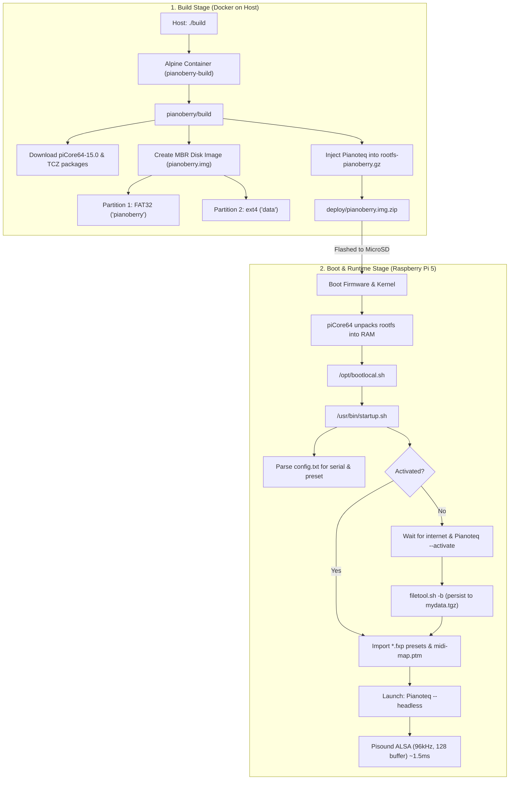
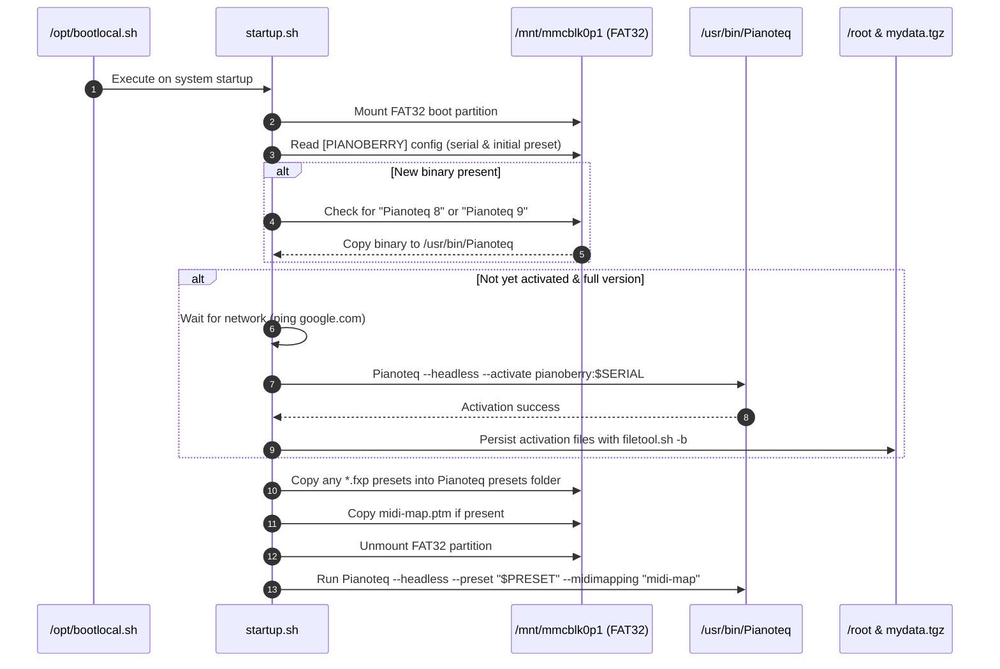

# Pianoberry: Architecture & Repository Overview

Pianoberry is a dedicated, headless digital piano appliance designed for the **Raspberry Pi 5** equipped with a **[Pisound](https://blokas.io/pisound/)** sound card. It runs Modartt's **[Pianoteq](https://www.modartt.com/pianoteq_overview)** (versions 8 or 9) physically modeled piano synthesizer with ultra-low audio latency (~1.5ms at 96 kHz / 128 buffer).

---

## 1. High-Level Architecture & Operating Principles



### 1.1 In-Memory Operating System (piCore64)
- **Base Distribution**: Pianoberry is built on [piCore64 15.0](http://repo.tinycorelinux.net/15.x/aarch64/) (the 64-bit ARM port of Tiny Core Linux).
- **RAM Execution**: The entire root filesystem (`rootfs-pianoberry.gz`) unpacks into RAM on startup. The MicroSD card is not mounted read-write during normal operation.
- **Power Safety**: Because system execution occurs in RAM and disk writes are minimal, the Raspberry Pi can be powered off at any moment by pulling the plug without risk of filesystem corruption.
- **Instant Readiness**: Minimal overhead allows fast boot directly into the synthesizer engine without display servers, desktop environments, or background daemons.

### 1.2 Dual-Partition Storage Layout
The disk image (`pianoberry.img`) is structured into two partitions:
1. **Partition 1 (FAT32, label `pianoberry`)**:
   - Contains Raspberry Pi boot firmware, kernel (`vmlinuz64`), `config.txt`, `cmdline.txt`, and `rootfs-pianoberry.gz`.
   - Formatted as FAT32 so users can insert the MicroSD card into any Windows, macOS, or Linux computer to configure presets, provide serial numbers, or copy custom `.fxp` preset files and binaries.
2. **Partition 2 (ext4, label `data`)**:
   - Contains `/tce/optional` holding all `.tcz` package extensions (ALSA, X11 client libraries, Mesa, FreeType, etc.) and `onboot.lst`.
   - Contains `/tce/mydata.tgz`, Tiny Core's persistent backup archive.

---

## 2. Boot & Execution Workflow ([`startup.sh`](file:///home/tim/git/pianoberry/pianoberry/startup.sh))

When the Raspberry Pi powers on, Tiny Core executes `/opt/bootlocal.sh`, which triggers `/usr/bin/startup.sh`:



1. **Mounts the Boot Partition**: Mounts `/mnt/mmcblk0p1` to inspect user-provided files.
2. **Parses Configuration**: Reads `pianoteq_serial` and `pianoteq_initial_preset` from the `[PIANOBERRY]` section of `config.txt`.
3. **Binary Upgrades**: If the user dropped an official ARM64 `Pianoteq 8` or `Pianoteq 9` binary onto the root of the SD card, the script installs it to `/usr/bin/Pianoteq`.
4. **Automated One-Time Activation**:
   - If `/opt/.activated` is absent and the binary supports the `--activate` flag, the script waits for an active internet connection.
   - Executes `/usr/bin/Pianoteq --headless --activate pianoberry:$PIANOTEQ_SERIAL`.
   - On success, marks `/opt/.activated`, adds `/root` and `/usr/bin/Pianoteq` to `/opt/.filetool.lst`, and executes `filetool.sh -b` to save license state into `mydata.tgz`. Subsequent boots require no internet.
5. **Preset & MIDI Mapping Sync**: Copies any `.fxp` files into `/root/.local/share/Modartt/Pianoteq/Presets/My Presets/` and copies `midi-map.ptm` if present.
6. **Engine Launch**: Unmounts `/mnt/mmcblk0p1` and starts Pianoteq in headless mode:
   ```bash
   sudo "/usr/bin/Pianoteq" --headless --preset "$PIANOTEQ_INITIAL_PRESET" --midimapping "midi-map"
   ```

---

## 3. Low-Latency Audio & MIDI Tuning

Pianoberry achieves ~1.5ms latency via hardware-matched ALSA settings:

- **Audio Hardware**: [Blokas Pisound](https://blokas.io/pisound/) ultra-low latency DAC/ADC hat for Raspberry Pi (auto-detected via on-board EEPROM).
- **ALSA Configuration** ([`Pianoteq.prefs`](file:///home/tim/git/pianoberry/pianoberry/Pianoteq.prefs)):
  - Sample rate: `96000.0 Hz`
  - Audio device buffer size: `128 samples` ($128 / 96000 \approx 1.33\text{ ms}$)
  - Internal sound card disabled: `sed -i 's/dtparam=audio=on/#dtparam=audio=on/g'`
  - Audio routing: `/etc/asound.conf` explicitly configures `hw:pisound,0` as the default ALSA plug so USB MIDI controllers with audio interfaces (e.g. StudioLogic SL Studio) cannot hijack card 0.
  - ALSA UMP Fix: Automatically prevents buffer underflow crash in `libasound.so.2` on kernels without `CONFIG_SND_SEQ_UMP`.
- **MIDI Input**:
  - `listen-all="1"` enabled in `Pianoteq.prefs`. Listens to both Pisound DIN MIDI ports and any class-compliant USB MIDI keyboard plugged into the Pi.
- **MIDI Mapping** ([`midi-map.ptm`](file:///home/tim/git/pianoberry/pianoberry/midi-map.ptm)):
  - CC 64: Sustain Pedal
  - CC 66: Sostenuto Pedal
  - CC 67: Soft Pedal
  - CC 71: Harmonic Pedal
  - CC 91: Felt Thickness
  - Pitch Bend: Range calibrated

---

## 4. What is in the Git Repository

```
pianoberry/
├── .github/
│   └── FUNDING.yml                 # GitHub sponsorship funding links
├── assets/                         # Branding and artwork
│   ├── logo.svg                    # Pianoberry logo (SVG)
│   ├── logo.afdesign               # Serif Affinity Designer vector source
│   ├── opengraph.png               # Social share preview image
│   └── opengraph.afdesign          # OpenGraph card design file
├── Dockerfile                      # Alpine builder image with disk formatting tools
├── build                           # Host-side wrapper script to launch Docker build
├── README.md                       # User documentation, flashing & activation guide
├── LICENSE                         # GNU General Public License v3.0
├── .gitignore                      # Ignore deploy/, trial binaries, OS metadata
└── pianoberry/                     # Core image construction and appliance payload
    ├── build                       # Internal image generation script (runs in Docker)
    ├── startup.sh                  # Runtime startup & activation script on the Pi
    ├── Pianoteq.prefs              # Optimized preferences template (ALSA, 96kHz, 128 buf)
    ├── midi-map.ptm                # Binary MIDI mapping file for pedals and controls
    └── mydata.tgz                  # Tiny Core Linux persistent configuration archive
```

### Detailed File Inventory

| Path | Purpose & Functionality |
| :--- | :--- |
| [**`build`**](file:///home/tim/git/pianoberry/build) | Host CLI script. Checks Docker, builds the `pianoberry-build` image if missing or requested (`--force-rebuild`), ensures `deploy/` exists, and runs unprivileged container image build. |
| [**`Dockerfile`**](file:///home/tim/git/pianoberry/Dockerfile) | Based on `alpine:3.21`. Installs userspace partition and filesystem tools (`parted`, `mtools`, `e2fsprogs`, `dosfstools`, `coreutils`, `advancecomp`, `zip`). |
| [**`pianoberry/build`**](file:///home/tim/git/pianoberry/pianoberry/build) | Automated pipeline that downloads `piCore64-15.0.0.zip` and all dependency `.tcz` packages; builds FAT32 and ext4 partitions using userspace tools; extracts, patches, and repacks `rootfs-pianoberry.gz`; and outputs `deploy/pianoberry.img.zip`. |
| [**`pianoberry/startup.sh`**](file:///home/tim/git/pianoberry/pianoberry/startup.sh) | Executed by Tiny Core during boot. Mounts FAT32 partition 1, reads settings, checks for license activation, syncs user presets and MIDI maps, applies ALSA UMP safety checks, and launches Pianoteq. |
| [**`pianoberry/Pianoteq.prefs`**](file:///home/tim/git/pianoberry/pianoberry/Pianoteq.prefs) | Default XML configuration copied to `Pianoteq84.prefs` through `Pianoteq95.prefs`. Configures ALSA device output at 96 kHz, 128 buffer size, multicore mode, and MIDI auto-listening. |
| [**`pianoberry/midi-map.ptm`**](file:///home/tim/git/pianoberry/pianoberry/midi-map.ptm) | Binary MIDI configuration mapping hardware MIDI CC numbers to Pianoteq parameters (pedals, felt strip, pitch bend). |
| [**`README.md`**](file:///home/tim/git/pianoberry/README.md) | Official documentation covering installation steps, license activation instructions, and build requirements. |
| [**`LICENSE`**](file:///home/tim/git/pianoberry/LICENSE) | GNU General Public License v3.0 text. |
| [**`assets/`**](file:///home/tim/git/pianoberry/assets) | Vector logos and social preview images for the project. |

---

## 5. User Configuration Options

When the SD card is plugged into a host computer, the user can edit `config.txt` on the `pianoberry` volume:

```ini
[PIANOBERRY]
pianoteq_serial=xxxx-xxxx-xxxx-xxxx
pianoteq_initial_preset=NY Steinway D Jazz
```

Optional files placed on the root of the `pianoberry` partition:
- `Pianoteq 8` or `Pianoteq 9`: Licensed ARM64 binary downloaded from Modartt account.
- `*.fxp`: Custom Pianoteq preset files (automatically imported to user presets folder).
- `midi-map.ptm`: Custom MIDI mapping overriding default mappings.
